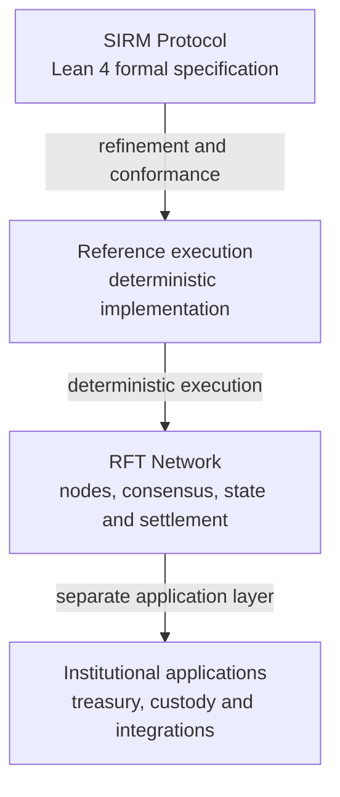

# SIRM Financial Infrastructure

[](LICENSE)
[](https://github.com/RFT-SIRM/SIRM-Financial-Infrastructure/actions/workflows/lean.yml)
[](docs/FORMALIZATION_STATUS.md)
[](docs/RELEASE_GATES.md)

**A formal financial-protocol foundation for the planned RFT Network.**

SIRM Financial Infrastructure specifies financial state, accounting rules,
and authorized transitions in Lean 4. Its purpose is to make core protocol
claims explicit, machine-checkable, reviewable, and suitable for later
implementation refinement.

**SIRM Protocol** is the normative financial model. **RFT Network** is the
planned sovereign execution and settlement network. **RFT** is its planned
native asset.

This repository is a formal specification and assurance foundation. It is
not a live bank, deployed blockchain, custody service, payment system, or
customer financial product.

---

## 1. Mission

Financial infrastructure needs more than application code and operational
promises. Its fundamental rules should be stated precisely, and important
safety properties should be proved against those rules.

The development principle is:

1. define the financial state and admissible transitions;
2. state the invariants that must remain true;
3. prove transition preservation and reachable-state safety in Lean;
4. exercise concrete theorem-level regression cases;
5. build deterministic implementations against the specification;
6. require separate implementation, security, operational, and legal
   evidence before production use.

A proof is only as broad as its theorem statement and assumptions. A green
Lean build does not automatically verify an unproved implementation,
network, custodian, reserve, or institution.

## 2. What is formalized

The current mathematical foundation is organized into the following
components.

| Component | Formal responsibility |
|---|---|
| `SIRM.FinancialCore` | Supply accounting, issuance and burn transitions, and exact founder-allocation arithmetic |
| `SIRM.Accounting` | Signed per-asset general-ledger journals and conservation for balanced postings |
| `SIRM.Holdings` | Nonnegative holder balances, reconciliation with outstanding supply, funded transfers, issuance, and holder-bounded burns |
| `SIRM.StateMachine` | Reachable-state safety from initial-state and transition-preservation obligations |
| `SIRM.Authorization` | Policy-parameterized authorization predicates and guarded transfer, issue, and burn operations |
| `SIRM.AuthorizedStateMachine` | Authorization-gated holder transitions and preservation of the holdings invariant |
| `SIRM.HolderAccountingBridge` | Matching general-ledger journals for holder transfers, issuance, and burns |
| `SIRM.AuthorizedFinancialMachine` | A combined holder-and-ledger state machine with reconciliation, subledger agreement, and aggregate ledger conservation |
| `SIRMTests.lean` | Concrete theorem-level regression scenarios compiled by `lake test` |

The combined financial machine is an important boundary: holder balances and
the signed general ledger are separate projections, and their relationship
must be expressed through explicit posting rules. They must not be added
together as if they were the same accounting quantity.

For the current declaration-by-declaration status, assumptions, and open
proof obligations, see
[Formalization Status](docs/FORMALIZATION_STATUS.md) and
[Mathematical Scope](docs/MATHEMATICAL_SCOPE.md).

## 3. Why Lean 4

Lean 4 provides a proof language and a small trusted kernel for checking
formal proof terms. In this repository it is used to encode:

- financial state and transition relations;
- arithmetic preconditions for admissible operations;
- conservation and reconciliation properties;
- authorization-gated state transitions;
- invariants that hold for all states reachable through the specified
  transition relation.

This does not eliminate the need to review the model itself. A formal
proof can be correct while its assumptions are incomplete, its state
universe is too narrow, or its relationship to a future implementation
remains unproved.

The project therefore keeps proved statements and unformalized requirements
separate and visible.

## 4. Target architecture

The repository is the first layer of a larger planned system.



The reference implementation, independent network software, consensus
protocol, custody integrations, and institutional applications are future
work. The diagram describes the target architecture, not components
claimed to be complete today.

## 5. Current financial design boundaries

### Supply and holder accounting

The holder view tracks outstanding units by account and asset. Its
reconciliation invariant assumes a complete account universe and that each
outstanding unit is counted exactly once.

### Signed general ledger

The general ledger represents signed postings by account and asset.
Balanced journals preserve aggregate signed balance per asset. The ledger
is distinct from the holder-supply projection.

### Authorization

The current authorization layer accepts an abstract, state-dependent
policy. It does not yet define a production identity registry, account
ownership system, cryptographic key custody, signatures, signer thresholds,
or permission-administration protocol.

### Genesis allocation

The current one-time founder allocation parameter is 1.309%, represented
as 13,090 parts per million:

\[
\operatorname{founder}(G)
=
\left\lfloor
\frac{13{,}090\,G}{1{,}000{,}000}
\right\rfloor.
\]

This is an explicit tokenomics policy input. It is not a theorem that the
selected percentage is economically optimal. Other genesis pools, supply,
decimals, custody, and vesting remain separate policy decisions.

## 6. Verification

The pinned Lean workflow runs both the project build and the theorem-level
test driver.

From the repository root:

```bash
lake build
lake test
```

The GitHub Actions workflow is
[Lean CI](.github/workflows/lean.yml). Its status badge above reports the
workflow result for `main`.

`lake test` compiles the `SIRMTests` library. These are theorem-level
regression checks, not randomized network tests or production runtime
fuzzing. Linting is intentionally disabled until a dedicated lint driver
is configured.

See [Testing](docs/TESTING.md) for the test scope and
[Release Gates](docs/RELEASE_GATES.md) for the requirements separating
formalization from implementation and deployment.

## 7. What is not yet established

The following are explicit future work, not implied by a successful build:

- a canonical typed asset registry and complete account universe;
- concrete principal-to-account ownership and permission administration;
- cryptographic identities, key custody, signatures, and signer thresholds;
- transaction nonces, expiry, replay protection, fees, and atomic failure;
- complete posting rules for institutional and control accounts;
- redemption obligations and external reserve evidence;
- governance, validator lifecycle, consensus safety and liveness;
- privacy and confidential-data disclosure mechanisms;
- a Rust implementation and a formal refinement argument linking it to Lean;
- independent security audits, operational controls, and jurisdictional
  legal and regulatory review.

The release process is staged. Passing one gate does not imply that a
later gate has been passed.

## 8. Licensing and project identity

The formal specification, Lean source, theorem-level tests, and covered
documentation in this repository are distributed under the
**Apache License 2.0**.

This is intentional: independent researchers, engineers, and institutions
must be able to inspect and verify the mathematical foundation under the
license terms.

Apache-2.0 does not grant general trademark rights. The names SIRM, RFT,
RFT Network, and related project identifiers must not be used to imply
official affiliation, endorsement, or certification without a separate
basis and permission.

Future production implementations or commercial services may have
separate licensing terms. Such terms do not cancel Apache-2.0 rights
already granted for material in this repository.

Read the
[Licensing and Intellectual Property Policy](docs/LICENSING_AND_IP_POLICY.md)
for the distinction between the formal specification, future products,
contributions, project identifiers, and possible future commercial
licensing.

## 9. Security and responsible use

Please report potential vulnerabilities privately where possible. See
[Security Policy](SECURITY.md).

Nothing in this repository constitutes a banking charter, money-transmitter
authorization, deposit-taking authority, reserve attestation, redemption
guarantee, regulatory approval, or permission to provide financial
services.

Formal verification is one part of an assurance process. Production use
would also require implementation correspondence, independent security
assessment, operational resilience, privacy controls, legal review, and
all applicable regulatory authorizations.

---

## Project documents

| Document | Purpose |
|---|---|
| [Formalization Status](docs/FORMALIZATION_STATUS.md) | What is formalized and what remains open |
| [Mathematical Scope](docs/MATHEMATICAL_SCOPE.md) | Theorems, assumptions, and assurance boundaries |
| [Testing](docs/TESTING.md) | Lean build and theorem-level regression tests |
| [Release Gates](docs/RELEASE_GATES.md) | Staged requirements for implementation and deployment |
| [Licensing and IP Policy](docs/LICENSING_AND_IP_POLICY.md) | Repository license, contributions, project identity, and future product licensing |
| [Contributing](CONTRIBUTING.md) | Contribution and review expectations |
| [Security Policy](SECURITY.md) | Responsible vulnerability reporting |
